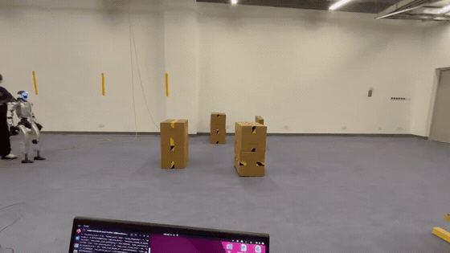
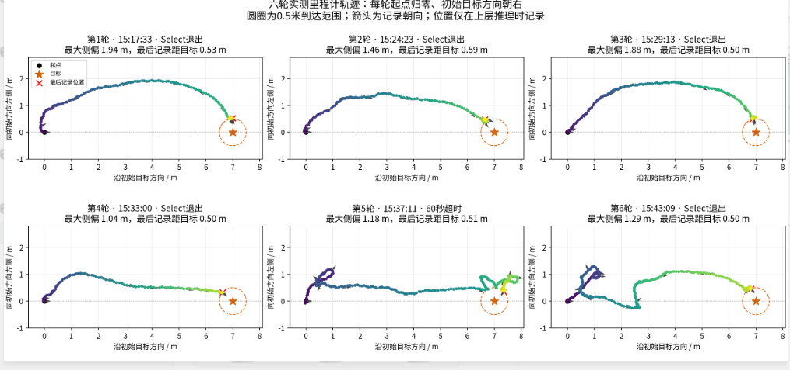
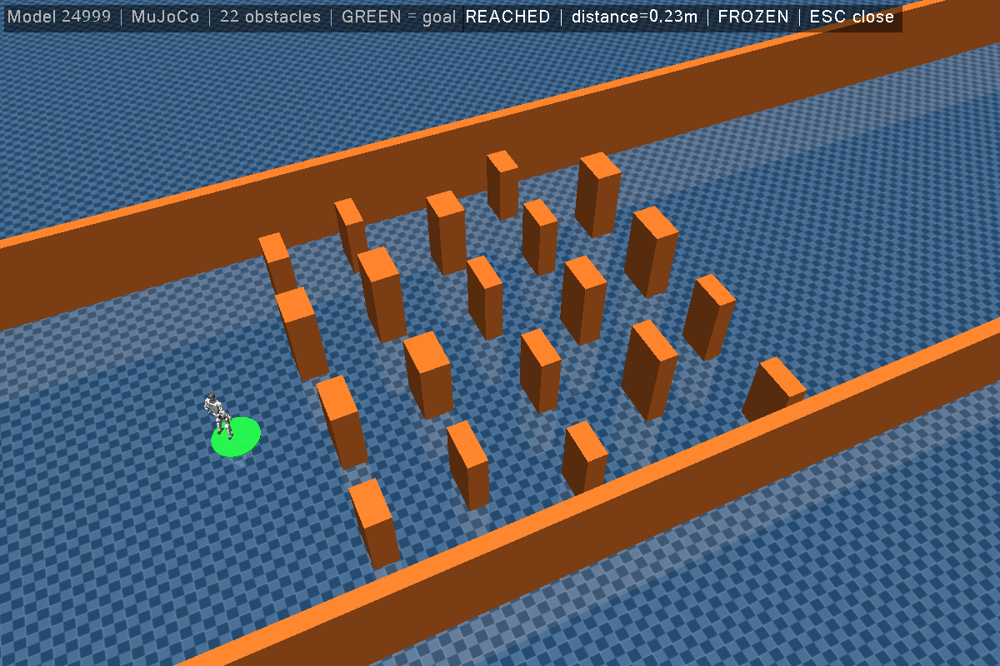

# Transformer-SRU Navigation

Unitree G1 29DOF 的分层导航强化学习：`LiDAR CNN → 空间 Transformer → SRU → [vx, vy, wz]`。
高层以5 Hz运行，冻结的 Unitree 低层以50 Hz执行速度指令。训练基于 Isaac Lab，支持 MuJoCo 验证和 ROS 2 部署。

## 真机部署展示

<table>
  <tr>
    <th width="50%">真机避障视频</th>
    <th width="50%">六组真机实验轨迹</th>
  </tr>
  <tr>
    <td align="center"><a href="docs/media/real-robot-demo.mp4"></a></td>
    <td align="center"><a href="docs/media/real-robot-six-trials.png"></a></td>
  </tr>
  <tr>
    <td align="center"><a href="docs/media/real-robot-demo.mp4">观看完整视频（含声音）</a></td>
    <td align="center"><a href="docs/media/real-robot-six-trials.png">查看原尺寸轨迹图</a></td>
  </tr>
</table>

左侧为原速静音动图预览，点击可查看完整视频。右图为里程计记录：5 轮 Select 退出、
1 轮 60 秒超时；圆圈表示目标 0.5 m 范围，位置仅在高层推理时记录。

发布模型实际为 **`checkpoints/model_24999.pt`**（约25000轮训练），附带对应 ONNX、训练配置和导出元数据。
这里没有另一份名为 `25000.pt` 的模型；原权重未改动。网络输入为1984维，其中 LiDAR 为 `16×41×3`。

## 安装

| 用途 | 环境与说明 |
|---|---|
| 训练、Isaac 回放 | Linux / NVIDIA GPU / Python 3.11 / Isaac Sim 5.1 / Isaac Lab v2.3.0；[安装步骤](training/README.md) |
| MuJoCo 仿真（PT / ONNX） | 与训练共用 `transformer_sru` / Python 3.11；[场景安装与启动](deploy/sim2sim/README.md) |
| ROS 2 真机部署 | Ubuntu 22.04 / Python 3.10；[依赖与启动](deploy/transformer_sru_real/README.md) |
| 实机传感器输入 | ROS 2 Humble / Unitree ROS 2 / Livox 点云和里程计；[适配器构建](ros/src/transformer_sru_lidar_adapter/README.md) |

克隆本仓库到纯英文路径，进入仓库根目录后执行以下命令。**训练与 sim2sim 只需一个 Python 3.11 环境**，统一安装入口见[训练文档](training/README.md)。
仅 ROS 2 Humble 真机部署使用独立的 Python 3.10 环境。
本仓库包含训练源码、G1 URDF/mesh、冻结低层策略和高度编码器；Isaac Lab、MuJoCo 场景及 ROS 依赖按上面文档安装。

## 训练与回放

完成训练环境安装后：

```bash
# 小规模检查启动、采样和 PPO 更新
python -u training/scripts/nav/train.py --num_envs 2 --max_iterations 2 --smoke_test --headless

# 正式训练：按显存调整 num_envs
python training/scripts/nav/train.py --num_envs 2048 --max_iterations 25000 --headless

# 回放发布权重
python training/scripts/nav/play.py --num_envs 1 --checkpoint checkpoints/model_24999.pt
```

日志与新权重位于 `logs/rsl_rl/g1_29dof_unitree_transformer_sru_ppo/`。
恢复训练、版本依据及显存说明见 [训练文档](training/README.md)。

## MuJoCo 避障演示（sim2sim）

使用原来的 **20 个障碍物＋两侧墙体**场景，直接加载 `model_24999.pt`。
本次复测约 **21.91 秒到达**，未触发碰撞或跌倒判定。[查看演示录像](deploy/sim2sim/demo.mp4)



完成[仿真依赖和场景安装](deploy/sim2sim/README.md)后（可复用训练环境，也可仅安装 CPU 演示依赖）：

```bash
conda activate transformer_sru  # 仅 CPU 演示环境则使用 transformer_sru_sim
bash deploy/sim2sim/run.sh
# 无窗口评估
bash deploy/sim2sim/run.sh --headless --start-delay 0 --hold 0
```

倒计时后自动导航，绿色圆盘为目标，Esc 退出。图形模式自动保存录像与轨迹。
该固定场景使用理想雷达，不代表总体成功率或实机表现；细节见[演示说明](deploy/sim2sim/README.md)。

## 部署发布模型

实机使用附带的 `model_24999.onnx`，无需重新导出。按[部署文档](deploy/transformer_sru_real/README.md)完成
传感器、网卡、外参和里程计配置，再进行只读检查及分阶段控制。仓库不提供 Livox 驱动或 SLAM；
默认不发送电机指令。离线/仿真检查不代表实机导航效果。
新训练权重的转换方法见 [ONNX 导出](tools/readonly_24999/README.md)。

## 目录

- `training/`：任务、PPO/Transformer-SRU、资产、训练和回放入口。
- `checkpoints/`：24999检查点、ONNX及配套配置。
- `deploy/`：MuJoCo、ROS 2推理与G1控制。
- `ros/src/`：LiDAR适配器源码和测试。
- `tools/`：ONNX导出与数值核对。

发布结构参考 [Unitree RL Lab](https://github.com/unitreerobotics/unitree_rl_lab)、
[Unitree RL Gym](https://github.com/unitreerobotics/unitree_rl_gym) 和
[SRU Navigation Sim](https://github.com/leggedrobotics/sru-navigation-sim)。
lys 拥有并有权授权的原创贡献采用 [MIT 许可证](LICENSE)，具体见[适用范围](LICENSE_SCOPE.md)。
第三方代码、权重及资产保留原许可，来源状态见 [THIRD_PARTY_NOTICES.md](THIRD_PARTY_NOTICES.md)。
